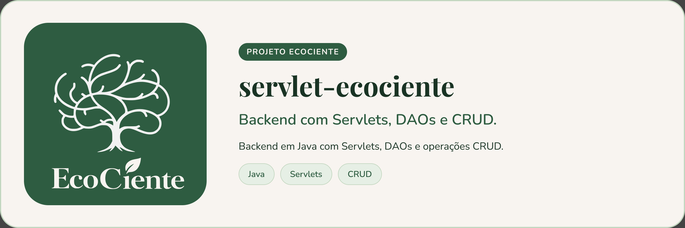
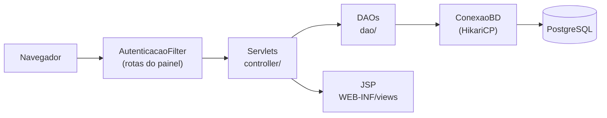

<p align="center">
  
</p>

# servlet-ecociente


> Aplicação web em Servlets e JSP do EcoCiente: cadastro de usuários e painel administrativo com CRUDs.

## Sobre o projeto

Aplicação Java (empacotada como WAR) com o padrão `controller` → `dao` → `model` e páginas JSP em `WEB-INF/views`. Usa PostgreSQL por JDBC, com pool HikariCP, e senhas com hash BCrypt (jBCrypt).

O que existe:

- **Cadastro** em etapas (tipo de perfil, dados pessoais, endereço, conta, condomínio/moradia e planos) para moradores, síndicos e cooperativas.
- **Login** (`LoginServlet`) e **painel administrativo** (`/painel`) com cards e gráficos, protegido por filtro.
- **CRUDs** de usuários, condomínios, cooperativas, moradores, síndicos, endereços, telefones e vínculos.

O `AutenticacaoFilter` bloqueia as rotas do painel e dos CRUDs: exige login e que o usuário seja administrador.



## Pré-requisitos

- JDK 25 (definido no `pom.xml`)
- Um contêiner de servlets compatível com Jakarta Servlet 6.1 para executar o WAR
- PostgreSQL acessível

## Instalando

```bash
git clone https://github.com/EcoCiente-Instituto-J-F/servlet-ecociente.git
cd servlet-ecociente
cp .env.example src/main/resources/.env   # Windows (PowerShell): Copy-Item .env.example src\main\resources\.env
```

A aplicação lê o `.env` do **classpath** (`src/main/resources/.env`, ignorado pelo Git). Variáveis:

| Variável | Descrição |
| --- | --- |
| `DB_URL` | URL JDBC, por exemplo `jdbc:postgresql://HOST:PORTA/BANCO?sslmode=require` |
| `DB_USER` | Usuário do banco |
| `DB_PASSWORD` | Senha do banco |

## Usando

```bash
./mvnw package        # Windows: .\mvnw.cmd package
```

O comando gera o WAR em `target/`; publique-o no contêiner de servlets. A classe `Main` apenas testa a conexão com o banco.

## Testes

O `pom.xml` já inclui o JUnit 5, mas ainda não há testes em `src/test`. Para compilar e executar os testes existentes:

```bash
./mvnw test
```

## Estrutura do projeto

```
src/main/
├── java/com/example/ecociente/
│   ├── controller/   # Servlets (cadastro, login, painel e CRUDs)
│   ├── dao/          # acesso ao banco (JDBC)
│   ├── model/        # entidades
│   ├── filter/       # AutenticacaoFilter
│   ├── conexao/      # ConexaoBD (HikariCP)
│   └── util/         # Senha (BCrypt), Formulario, DadoInvalido
└── webapp/
    ├── WEB-INF/views/  # páginas JSP
    └── assets/         # imagens
```

## Contribuindo

Leia o [CONTRIBUTING.md](CONTRIBUTING.md) antes de abrir uma Pull Request. Ao participar, você concorda com o [Código de Conduta](CODE_OF_CONDUCT.md).

## Segurança

Encontrou uma vulnerabilidade? Siga o [SECURITY.md](SECURITY.md). **Não abra issue pública.**

## Licença

Este projeto está sob a licença MIT. Veja o arquivo [LICENSE](LICENSE).
